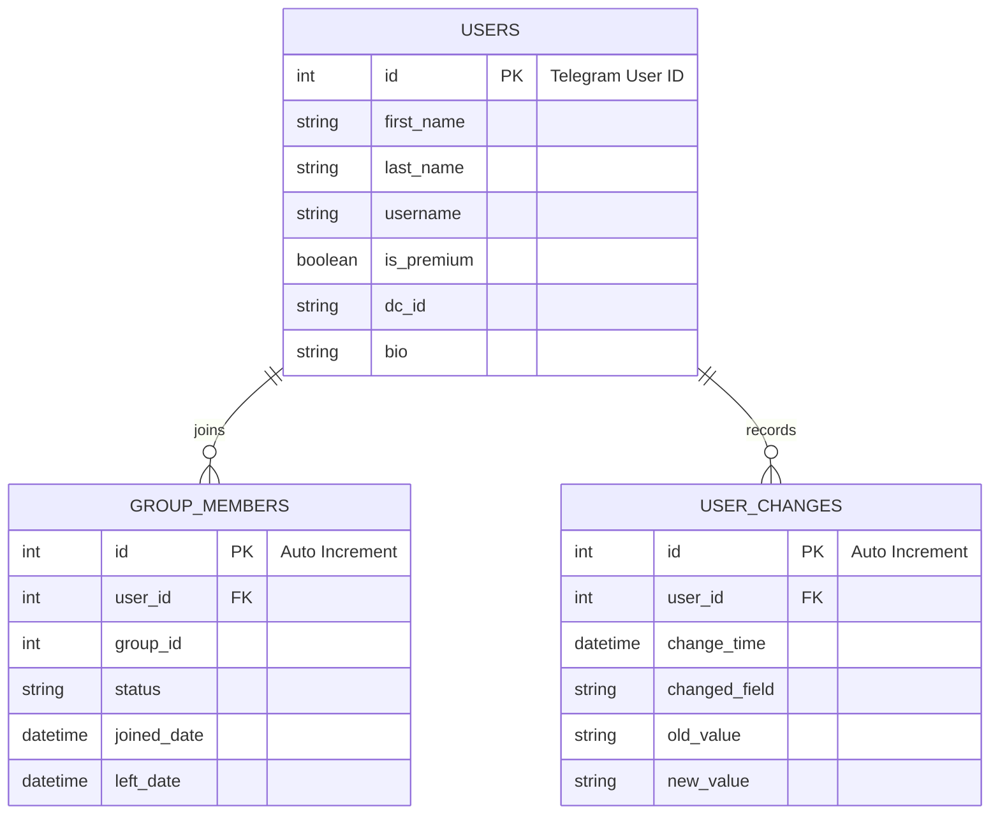

# 🗄️ Telegram Bot Database Selection Guide

Hiện tại, bot của bạn đang lưu trữ dữ liệu dưới dạng các file JSON phẳng:
* `members.json` (Chứa dữ liệu lồng nhau phức tạp: thông tin hiện tại, danh sách nhóm đã tham gia, lịch sử thay đổi thông tin).
* `user_violations.json` (Lịch sử vi phạm bad words).
* `banlist.json` (Danh sách thành viên bị cấm/mute).
* `known_users.json` (Danh sách người dùng đã tương tác qua private chat).

Mặc dù file JSON dễ đọc và phát triển nhanh ở giai đoạn đầu, nhưng khi bot hoạt động thực tế với nhiều group hoặc lượng tin nhắn lớn, nó sẽ gặp các vấn đề lớn:
1. **Race Condition:** Hai tin nhắn xử lý song song có thể đọc cùng một lúc và ghi đè đứt đoạn dữ liệu của nhau (`_load_data()` và `_save_data()` không có lock).
2. **Hiệu năng I/O:** Mỗi khi có thay đổi nhỏ (như user nhắn tin hoặc đổi tên), bot phải đọc/ghi lại toàn bộ file JSON dung lượng lớn.
3. **Bộ nhớ:** Load toàn bộ file JSON vào RAM (`in-memory`) có thể gây tràn RAM khi tệp tin lớn dần.

Dưới đây là phân tích chi tiết các giải pháp thay thế tối ưu nhất cho hệ thống của bạn.

---

## 📊 Bảng So Sánh Các Hệ Cơ Sở Dù Liệu

| Tiêu chí | 🐿️ SQLite | 🍃 MongoDB | 🐘 PostgreSQL | ⚡ Redis |
| :--- | :--- | :--- | :--- | :--- |
| **Loại CSDL** | Relational (SQL) | NoSQL (Document-based) | Relational (SQL) | In-Memory (Key-Value) |
| **Cài đặt & Vận hành** | **Dễ nhất** (Chỉ là 1 file `.db` cục bộ, không cần cài server) | **Trung bình** (Cần chạy service MongoDB hoặc dùng Cloud Atlas miễn phí) | **Khó hơn** (Cần cấu hình Server PostgreSQL, quản lý kết nối) | **Dễ/Trung bình** (Cần cài server Redis để lưu cache) |
| **Độ khớp cấu trúc JSON hiện tại** | **Thấp/Trung bình** (Cần tách thành các bảng quan hệ hoặc dùng cột JSON) | **Tuyệt đối** (Dữ liệu dạng BSON khớp 100% với cấu trúc nested JSON hiện tại) | **Trung bình/Cao** (Hỗ trợ cột kiểu `JSONB` truy vấn cực mạnh) | **Thấp** (Chỉ phù hợp lưu session/cache tạm thời) |
| **Xử lý bất đồng bộ (Async)** | **Hạn chế** (Thư viện mặc định đồng bộ, cần dùng `aiosqlite` để tránh chặn event loop) | **Tuyệt vời** (Thư viện `motor` hỗ trợ async hoàn hảo cho `python-telegram-bot`) | **Tuyệt vời** (Hỗ trợ async qua `asyncpg` hoặc ORM nâng cao) | **Tuyệt vời** (Async qua `aioredis`/`redis-py`) |
| **Ngăn chặn Race Condition** | **Tốt** (Hỗ trợ ACID transactions, khóa file khi ghi) | **Rất tốt** (Cập nhật nguyên tử từng trường bằng toán tử `$set`, `$push`) | **Xuất sắc** (Hỗ trợ ACID transactions, khóa hàng/bảng) | **Không áp dụng** (Chỉ dùng khóa tạm thời distributed lock) |
| **Chi phí hosting** | **0 VNĐ** (Chạy trực tiếp trên VPS cùng với Bot) | **0 VNĐ** (Có gói Free 512MB trên MongoDB Atlas Cloud) | **Cần trả phí** hoặc tự cài trên VPS (tốn RAM/CPU) | **Tự cài trên VPS** (tiêu thụ RAM) |

---

## 🛠️ Chi Tiết Lựa Chọn & Cách Di Chuyển Code

> [!TIP]
> Do bot của bạn viết bằng kiến trúc **Async (Bất đồng bộ)** của thư viện `python-telegram-bot` và Telethon, các tương tác với DB cũng **bắt buộc** phải là bất đồng bộ để tránh làm "đơ" bot khi xử lý hàng trăm tin nhắn cùng lúc.

### Lựa chọn 1: MongoDB (Tối ưu nhất cho cấu trúc dữ liệu hiện tại)

Nếu bạn muốn **giữ nguyên cấu trúc dữ liệu hiện tại** mà không cần thiết kế lại cơ sở dữ liệu quan hệ phức tạp, **MongoDB** là lựa chọn số 1. Nó cho phép bạn truy vấn thẳng vào các mảng hoặc sub-document lồng nhau.

#### Cấu trúc MongoDB Document cho `members.json`:
```json
{
  "_id": 5877290229, // Telegram User ID
  "current_info": {
    "first_name": "Kimi",
    "last_name": "Dev",
    "username": "kimidev",
    "is_premium": true
  },
  "groups": [
    {
      "group_id": -100123456789,
      "status": "member",
      "joined": "2026-05-20T05:23:47Z",
      "left": null
    }
  ],
  "changes": [
    {
      "time": "2026-05-20T05:30:00Z",
      "changed_fields": {
        "username": "old_username"
      }
    }
  ]
}
```

#### Code Python (Async với `motor`):
```python
import motor.motor_asyncio
from datetime import datetime

# Kết nối (Ví dụ MongoDB Atlas hoặc Local)
client = motor.motor_asyncio.AsyncIOMotorClient("mongodb://localhost:27017")
db = client["telegram_bot_db"]
members_col = db["members"]

async def track_member_join(user_id: int, group_id: int, user_info: dict):
    # Cập nhật thông tin hiện tại và push group mới vào mảng
    await members_col.update_one(
        {"_id": user_id},
        {
            "$set": {
                "current_info": {
                    "first_name": user_info.get("first_name"),
                    "last_name": user_info.get("last_name"),
                    "username": user_info.get("username"),
                    "is_premium": user_info.get("is_premium")
                }
            },
            # Chỉ thêm vào mảng groups nếu chưa tồn tại group này
            "$addToSet": {
                "groups": {
                    "group_id": group_id,
                    "status": "member",
                    "joined": datetime.utcnow().isoformat(),
                    "left": null
                }
            }
        },
        upsert=True # Tạo mới nếu chưa có user này
    )
```

---

### Lựa chọn 2: SQLite (Gọn nhẹ nhất, Zero-Config)

Nếu bạn muốn hệ thống **gọn nhẹ**, toàn bộ ứng dụng nằm trong một thư mục duy nhất mà không cần cài đặt phần mềm bên thứ ba hay tạo tài khoản cloud, **SQLite** là lựa chọn tuyệt vời.

#### Cấu trúc bảng SQL thiết kế lại từ `members.json`:
Để lưu bằng SQL hiệu quả, bạn nên tách thành 3 bảng quan hệ để tránh trùng lặp dữ liệu:



#### Code Python (Async với `aiosqlite`):
```python
import aiosqlite

DB_FILE = "data/bot_database.db"

async def init_db():
    async with aiosqlite.connect(DB_FILE) as db:
        # Tạo bảng Users
        await db.execute("""
            CREATE TABLE IF NOT EXISTS users (
                id INTEGER PRIMARY KEY,
                first_name TEXT,
                last_name TEXT,
                username TEXT,
                is_premium INTEGER
            )
        """)
        # Tạo bảng Group Members
        await db.execute("""
            CREATE TABLE IF NOT EXISTS group_members (
                id INTEGER PRIMARY KEY AUTOINCREMENT,
                user_id INTEGER,
                group_id INTEGER,
                status TEXT,
                joined_date TEXT,
                left_date TEXT,
                FOREIGN KEY(user_id) REFERENCES users(id)
            )
        """)
        await db.commit()

async def track_member_join(user_id: int, group_id: int, user_info: dict):
    async with aiosqlite.connect(DB_FILE) as db:
        # Cập nhật hoặc chèn User
        await db.execute("""
            INSERT INTO users (id, first_name, last_name, username, is_premium)
            VALUES (?, ?, ?, ?, ?)
            ON CONFLICT(id) DO UPDATE SET
                first_name=excluded.first_name,
                last_name=excluded.last_name,
                username=excluded.username,
                is_premium=excluded.is_premium
        """, (user_id, user_info['first_name'], user_info['last_name'], user_info['username'], 1 if user_info['is_premium'] else 0))
        
        # Thêm lịch sử tham gia nhóm
        await db.execute("""
            INSERT INTO group_members (user_id, group_id, status, joined_date, left_date)
            VALUES (?, ?, ?, datetime('now'), NULL)
        """, (user_id, group_id, "member"))
        
        await db.commit()
```

---

## 📌 Lời Khuyên & Đề Xuất Cuối Cùng

Dựa trên cấu trúc bot của bạn hiện tại, tôi đề xuất bạn lựa chọn theo 2 hướng sau:

### Hướng 1: Chọn MongoDB (Khuyên dùng cho dự án này)
* **Lý do:**
  1. Giữ nguyên được cấu trúc dữ liệu lồng nhau phức tạp của bạn mà không phải mất công chia nhỏ thành nhiều bảng SQL quan hệ phức tạp.
  2. Thư viện `motor` (Async MongoDB) cực kỳ mạnh mẽ, chạy bất đồng bộ hoàn hảo với Telegram Bot API và Telethon mà không bị block event loop.
  3. Bạn có thể sử dụng dịch vụ Cloud miễn phí **MongoDB Atlas** để lưu trữ, giúp dễ dàng kiểm tra dữ liệu từ bất kỳ đâu qua GUI (MongoDB Compass) mà không cần lo lắng về việc sao lưu file database trên VPS.

### Hướng 2: Chọn SQLite + ORM (Nếu muốn tự quản lý cục bộ offline)
* **Lý do:**
  1. Không muốn phụ thuộc vào cloud bên ngoài, muốn sao lưu đơn giản bằng cách copy đúng 1 file duy nhất (`.db`).
  2. Sử dụng ORM như **Peewee** hoặc **SQLAlchemy** kết hợp với SQLite để quản lý database dễ dàng bằng Class Python.
  3. Có thể dùng cột kiểu `JSON` có sẵn của SQLite để lưu giữ các phần lồng nhau phức tạp (ví dụ cột `changes` có thể lưu trực tiếp chuỗi JSON).

---

> [!NOTE]  
> Nếu bạn quyết định chọn phương án nào, tôi có thể hỗ trợ bạn:
> 1. Viết một script migrate tự động để chuyển đổi toàn bộ dữ liệu từ các file JSON hiện có (`members.json`, `user_violations.json`, `banlist.json`) sang cơ sở dữ liệu mới mà không bị mất lịch sử của các thành viên.
> 2. Viết lại tầng Services kết nối dữ liệu (`services/group_member_tracker.py`, `services/banlist_service.py`...) để tích hợp DB mới một cách an toàn.

Bạn thấy phương án nào thuận tiện và phù hợp với định hướng phát triển bot của bạn hơn?
