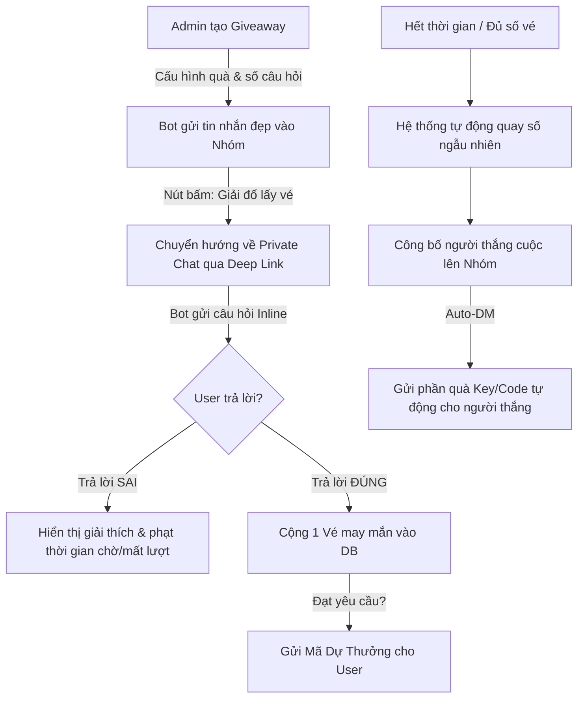

# 🎁 HỆ THỐNG QUIZ GIVEAWAY — KIẾN TRÚC & QUY TRÌNH VẬN HÀNH

Ý tưởng cốt lõi: **Biến việc nhận quà thành một trò chơi tương tác.** Người dùng sẽ phải tham gia trả lời các câu hỏi trắc nghiệm (lấy từ `questions.json`) qua Chat riêng với Bot để tích lũy **Vé may mắn (Tickets)**. Nhiều vé $\rightarrow$ Tỷ lệ trúng giải càng cao.

---

## 🗺️ Sơ đồ Quy trình Vận hành (Workflow)



---

## 🗄️ Thiết kế Cơ sở Dữ liệu (Database Schema)

Để lưu trữ các chiến dịch Giveaway, vé dự thưởng và kho quà tặng, chúng ta tạo thêm file `data/giveaways.json`:

```json
{
  "active_giveaway": {
    "campaign_id": "gv_20260523",
    "prize_name": "Tài khoản Netflix Premium 1 Tháng",
    "prize_pool": ["netflix_acc_1", "netflix_acc_2", "netflix_acc_3"],
    "winners_count": 3,
    "category": "MEO",
    "questions_required": 3,
    "end_time": "24/05/2026 21:00:00",
    "created_by": "Kimi Admin",
    "status": "running"
  },
  "tickets": {
    "gv_20260523": [
      {
        "ticket_id": "TK-10001",
        "user_id": 7858340817,
        "username": "user1",
        "full_name": "Nguyen Van A",
        "earned_at": "23/05/2026 21:05:00"
      },
      {
        "ticket_id": "TK-10002",
        "user_id": 7257861001,
        "username": "user2",
        "full_name": "Tran Thi B",
        "earned_at": "23/05/2026 21:06:12"
      }
    ]
  },
  "history": []
}
```

---

## 🛠️ Quy trình Triển khai Code & Cách tích hợp

### Bước 1: Admin tạo chiến dịch dự thưởng bằng câu lệnh
Lệnh admin trong nhóm hoặc private:
> `/giveaway create <Tên Quà>|<Số Giải>|<Chủ Đề>|<Số Câu Hỏi Trúng Vé>|<Thời Gian Chờ (phút)>`
> *Ví dụ:* `/giveaway create Netflix 1 Tháng|3|MEO|3|60` (Tạo giveaway Netflix, 3 giải, chủ đề câu đố Mẹo, trả lời đúng 3 câu sẽ được 1 vé, hạn trong 60 phút).

### Bước 2: Tích hợp vào Deep Link Dispatcher (`deeplinks.py`)
Khi người dùng bấm vào nút **`🎟 Nhận vé tham gia`** ở tin nhắn nhóm, link sẽ dẫn về Private Chat: `t.me/your_bot?start=giveaway_gv20260523`.

Trong `bot/commands/deeplinks.py`, chúng ta đăng ký thêm handler `"giveaway"`:
```python
# Đăng ký vào DEEPLINK_REGISTRY:
DEEPLINK_REGISTRY = {
    "check_violation": handle_check_violation,
    "giveaway": handle_giveaway_start, # <--- TÍCH HỢP MỚI
}

async def handle_giveaway_start(update: Update, context: ContextTypes.DEFAULT_TYPE, payload: str | None = None):
    """
    Xử lý khi người dùng click link tham gia Giveaway từ nhóm
    payload ở đây chính là campaign_id (ví dụ: "gv20260523")
    """
    # 1. Kiểm tra campaign_id có tồn tại và đang chạy không.
    # 2. Kiểm tra xem người dùng này đã nhận vé chưa (tránh spam).
    # 3. Gửi câu hỏi trắc nghiệm đầu tiên kèm các nút Inline (Lấy ngẫu nhiên từ câu hỏi thuộc danh mục chỉ định trong questions.json).
```

### Bước 3: Cơ chế tương tác trả lời câu hỏi (Quiz Callback)
* Sử dụng `CallbackQueryHandler` để bắt sự kiện người dùng bấm chọn đáp án A, B, C, D.
* So khớp lựa chọn của user với đáp án đúng (`CO` trong `questions.json`).
* **Nếu đúng:** Cộng điểm tiến trình (Ví dụ: 1/3 câu đúng) $\rightarrow$ Đạt 3/3 thì cấp mã vé `TK-xxxxx` và ghi vào DB.
* **Nếu sai:** Hiện giải thích (`EX` trong `questions.json`) để người dùng học thêm kiến thức, đồng thời tạo cảm giác thử thách hấp dẫn.

### Bước 4: Quay số tự động (Draw)
* Khi đến `end_time`, hệ thống kích hoạt hàm quay thưởng.
* Dùng hàm `random.sample` để bốc thăm ngẫu nhiên số lượng người chiến thắng dựa trên danh sách Vé may mắn đã phát hành.
* Gửi tin nhắn thông báo dạng thẻ chúc mừng cực kỳ premium lên Nhóm và tự động inbox gửi tài khoản Netflix/Mã quà tặng cho người thắng.

---

## 🌟 Tại sao ý tưởng này lại vô cùng Premium?

1. **Chống Tài Khoản Clone (Anti-Cheat) Tuyệt Đối:** User bắt buộc phải thực hiện hành động giải đố, bot rác không thể tự động trả lời đúng chuỗi câu hỏi ngẫu nhiên được.
2. **Kéo Lượng Người Dùng Chat Riêng Với Bot:** Bắt buộc phải qua Private Chat giải đố giúp Bot thu thập được ID chat riêng của rất nhiều thành viên $\rightarrow$ Phục vụ cho tính năng gửi thông báo (Broadcast) sau này cực kỳ hiệu quả.
3. **Tính Giáo Dục & Giải Trí Cao:** Giúp các thành viên trong nhóm không bị nhàm chán, tạo sân chơi tương tác thông minh cho cộng đồng của bạn.
